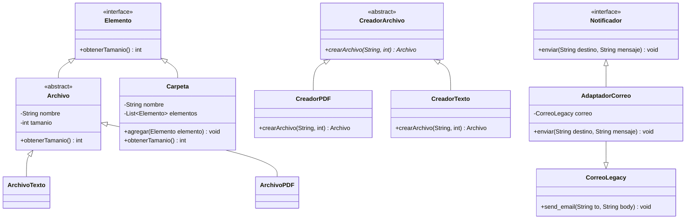

# ANALISIS.md — Práctica 3: Refactorización y Diseño Modular

## 1. Etapa 1: Diagnóstico del Programa Inicial

### 1.1. Análisis de responsabilidades iniciales en Main
1. **agregarArchivo**: Se encarga de inspeccionar mediante condicionales (if/else) el tipo de archivo solicitado ("pdf" o "txt"), instanciar la clase concreta correspondiente (ArchivoPDF o ArchivoTexto) y añadirla directamente a la lista interna archivos de la carpeta recibida.
2. **obtenerTamanio**: Se encarga de calcular el tamaño total sumando primero los tamaños de todos los archivos contenidos en la carpeta y, posteriormente, iterando sobre la lista de subcarpetas para invocar recursivamente obtenerTamanio(subcarpeta).
3. **enviarResultado**: Se encarga de instanciar directamente el servicio de correo CorreoLegacy, construir la cadena con el tamaño total calculado y llamar al método específico send_email(to, body).

---

### 1.2. Tres problemas concretos de diseño detectados

#### Problema 1: Creación rígida y dispersa con condicionales (Falta Factory Method)
* **Dónde aparece:** En el método agregarArchivo de la clase Main.
* **Qué cambio sería difícil:** Si se desea soportar nuevos tipos de archivo (por ejemplo, imágenes, audio o ejecutables), sería obligatorio modificar agregarArchivo agregando más ramas else if, violando el **Principio de Abierto/Cerrado (OCP)** y concentrando la lógica de creación en el cliente.
* **Clase o interfaz responsable:** Una jerarquía de creadores abstractos y concretos mediante el patrón **Factory Method** (CreadorArchivo, CreadorPDF, CreadorTexto).

#### Problema 2: Tratamiento desigual de archivos y carpetas (Falta Composite)
* **Dónde aparece:** En los atributos de Carpeta (archivos y subcarpetas por separado) y en el método obtenerTamanio de Main.
* **Qué cambio sería difícil:** Cualquier operación jerárquica (contar elementos, calcular tamaños, aplicar permisos) obliga al cliente a distinguir entre hojas y ramas mediante dos bucles y lógica recursiva externa. Si se agrega un nuevo tipo de contenedor (por ejemplo, accesos directos o archivos comprimidos), todo el cálculo externo se rompería.
* **Clase o interfaz responsable:** Una abstracción común **Composite** (Elemento), implementada tanto por la hoja (Archivo) como por el compuesto (Carpeta), de modo que cada componente sea responsable de responder a obtenerTamanio().

#### Problema 3: Fuerte acoplamiento con una biblioteca/servicio externo (Falta Adapter)
* **Dónde aparece:** En el método enviarResultado de Main, al instanciar new CorreoLegacy() y depender del nombre de método send_email.
* **Qué cambio sería difícil:** Si se sustituye el proveedor de correo por otro servicio (SendGrid, notificaciones push, SMS) o si la API externa cambia el nombre de su método a enviar, se tendría que reescribir la lógica de negocio. Además, no se puede hacer pruebas con dobles de prueba (mocks).
* **Clase o interfaz responsable:** Una interfaz de dominio Notificador (con método enviar(destino, mensaje)) y una clase adaptadora AdaptadorCorreo (**Adapter**) que encapsule CorreoLegacy.

---

## 2. Etapa 2: Pruebas Iniciales (Antes de Refactorizar)

Antes de alterar la arquitectura del código, se diseñaron y ejecutaron 5 casos de prueba de regresión para asegurar que cualquier refactorización posterior preserve la corrección del cálculo.

| Caso | Entrada / Escenario | Tamaño Esperado | Tamaño Obtenido | Resultado |
| :--- | :--- | :---: | :---: | :---: |
| 1 | Carpeta vacía (Vacia) | 0 | 0 | **OK** |
| 2 | Carpeta con un PDF de tamaño 120 | 120 | 120 | **OK** |
| 3 | Carpeta con PDF de 120 y Texto de 80 | 200 | 200 | **OK** |
| 4 | Ejemplo completo: Carpeta padre con PDF(120), TXT(80) y subcarpeta con TXT(50) | 250 | 250 | **OK** |
| 5 | Carpeta con un archivo de tamaño 0 | 0 | 0 | **OK** |

---

## 3. Etapas 3, 4 y 5: Patrones de Diseño Implementados

### 3.1. Patrón Composite (Estructural)
* **Objetivo:** Tratar objetos individuales y composiciones de objetos de manera uniforme.
* **Implementación:**
  * Se definió la interfaz Elemento con el método int obtenerTamanio().
  * La clase abstracta Archivo implementa Elemento devolviendo directamente su atributo tamanio.
  * La clase Carpeta implementa Elemento, eliminando las dos listas separadas y manteniendo una única lista `List<Elemento> elementos`.
  * Carpeta.obtenerTamanio() suma recursiva y polimórficamente los tamaños invocando elemento.obtenerTamanio(), sin requerir ningún if.

### 3.2. Patrón Factory Method
* **Objetivo:** Definir una interfaz para crear un objeto, permitiendo que las subclases decidan qué clase instanciar.
* **Implementación:**
  * Se creó la clase abstracta CreadorArchivo con el método de fábrica: abstract Archivo crearArchivo(String nombre, int tamanio).
  * Se definieron creadores concretos: CreadorPDF y CreadorTexto.
  * Se eliminó el método monolítico agregarArchivo con sentencias if/else.

### 3.3. Patrón Adapter
* **Objetivo:** Permitir que dos interfaces incompatibles colaboren.
* **Implementación:**
  * Se definió la interfaz objetivo Notificador con el método void enviar(String destino, String mensaje).
  * Se creó la clase AdaptadorCorreo que implementa Notificador y mantiene una referencia interna a CorreoLegacy.
  * Traduce la llamada enviar(destino, mensaje) hacia correo.send_email(destino, mensaje).
  * enviarResultado ahora recibe un Notificador inyectado por parámetro en lugar de crear directamente el servicio concreto.

---

## 4. Etapa 6: Verificación Posterior y Análisis Final

### 4.1. Resultados de las pruebas tras la refactorización
Se ejecutaron los mismos cinco casos de prueba sobre el código refactorizado:

| Caso | Entrada / Escenario | Tamaño Esperado | Tamaño Obtenido | Coincide (OK/FALLO) |
| :--- | :--- | :---: | :---: | :---: |
| 1 | Carpeta vacía | 0 | 0 | **OK** |
| 2 | Carpeta con PDF de 120 | 120 | 120 | **OK** |
| 3 | Carpeta con PDF de 120 y Texto de 80 | 200 | 200 | **OK** |
| 4 | Ejemplo completo con subcarpeta de 50 | 250 | 250 | **OK** |
| 5 | Carpeta con archivo de tamaño 0 | 0 | 0 | **OK** |

**Salida de main() tras la refactorización:**
```
250
Para: profesor@universidad.edu
Tamanio total: 250
```
La salida es exactamente idéntica carácter por carácter respecto al punto de partida.

---

### 4.2. Diagrama de Clases del Sistema Refactorizado



---

### 4.3. Respuestas de Reflexión

#### ¿Qué responsabilidad se movió a cada clase?
* **Cálculo de tamaño individual:** Se movió al propio Archivo, que conoce su tamaño intrínseco.
* **Cálculo de tamaño compuesto y recorrido recursivo:** Se movió a Carpeta, delegando polimórficamente en cada uno de sus elementos. Main ya no sabe cómo sumar ni cómo recorrer subdirectorios.
* **Construcción de instancias de archivo:** Se movió a las clases de fábrica (CreadorPDF, CreadorTexto). Main ya no decide con if/else la instanciación de objetos.
* **Traducción e integración del servicio de correo:** Se movió a AdaptadorCorreo. Main y enviarResultado ahora dependen de la abstracción Notificador, eliminando el conocimiento directo de CorreoLegacy.

#### ¿Qué permaneció igual para quien usa el programa?
* El resultado final y los efectos observables permanecieron exactamente iguales: la consola sigue mostrando **250** y el correo simulado con **Para: profesor@universidad.edu** y **Tamanio total: 250**.
* Se preservó el flujo funcional del usuario: crear archivos, agruparlos en carpetas jerárquicas, consultar el tamaño total y notificarlo al destinatario.
